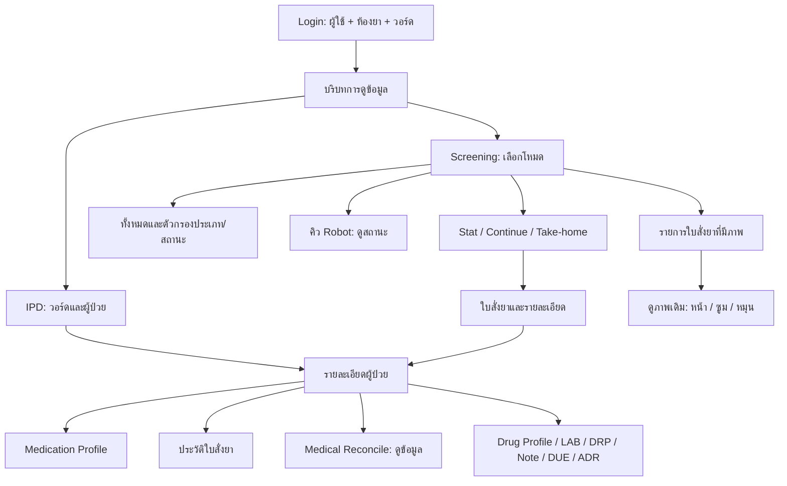

# เปรียบเทียบ Windows กับเว็บ: ห้องยา IPD แบบดูข้อมูล

ตรวจวันที่ 18 ตุลาคม 2026 จาก source Windows `Interface_ver852_scan_checkout_4-7-2026` และเว็บ `host` revision `772f0dd`

- Windows root: `C:/Users/fAm NoteBook/Desktop/Unidose hospital/Interface_ver852_scan_checkout_4-7-2026/Interface`
- Web root: `C:/Users/fAm NoteBook/Desktop/host`
- [รายการงานแบบ checklist](IPD-READONLY-BACKLOG.md)
- Screening: เพิ่ม Stat รอจัด/จัดแล้วและตัวเลือกทุกห้องจาก master จริงแล้ว ดู [ผลดำเนินการและข้อจำกัด](IPD-SCREENING-STAT.md); รายการบั๊ก Screening ด้านล่างเป็น baseline ของ `Screenning.jsx` เดิมซึ่งไม่ได้ mount ในเส้นทางใหม่นี้ โหมดอื่นยังรอพัฒนา
- เพิ่ม Continue รอจัด (ยารอ Screen และส่งจัดยา) ใน container เดิมแล้ว เลือกห้องยา/วัน/วอร์ด/ใบและกลับจาก patient view ได้ ดู [ผลดำเนินการ Continue](IPD-SCREENING-CONTINUE.md); Continue จัดแล้วและโหมดอื่นยังรอพัฒนา
- เพิ่ม Continue จัดแล้วด้วย `continue-finished` แล้ว เลือกห้องครบทุกระดับ โดยระบุจุดแก้ยอดวอร์ด native ที่เดิมรวมทุกห้อง ดู [ผลดำเนินการ Continue จัดแล้ว](IPD-SCREENING-CONTINUE-FINISHED.md); All/Take-home/Robot/ภาพใบสั่งยายังรอพัฒนา
- เพิ่ม Robot แบบดูข้อมูลจาก `packagemaster` แยก source จาก Stat/Continue แล้ว เลือกห้องครบทุกระดับ ดู [ผลดำเนินการ Robot](IPD-SCREENING-ROBOT.md); All/Take-home/ภาพใบสั่งยายังรอพัฒนา
- แก้ Robot ตาม Windows หลังผู้ใช้ทักท้วง: มีเฉพาะหอ/ใบสองตาราง เริ่มทุกห้องและเห็นทุกหอที่มีคิว ไม่มีตารางยาด้านล่าง ตัวกรองห้องเฉพาะเป็นตัวเลือกเสริม — ดู [ผลตรวจ Robot ล่าสุด](IPD-SCREENING-ROBOT.md)
- รายงานนี้เป็น baseline ก่อนเริ่มแก้; ดู [ผลดำเนินการ Login/IPD เฟสแรก](LOGIN-IPD-IMPLEMENTATION.md) สำหรับสถานะล่าสุด **คำขอล่าสุดเปลี่ยนเป็นเลือกเฉพาะห้องยาที่ login แล้วเลือกวอร์ดในหน้า IPD** จึงยกเลิกข้อเสนอเลือกวอร์ดที่ login ใน baseline ด้านล่าง
- ผู้ใช้แจ้งว่า MySQL ทุกส่วนต้องเข้าถึงผ่านเครือข่ายภายในโรงพยาบาล ให้เตรียมโค้ดไว้ก่อนแล้วค่อยตรวจข้อมูลจริงเมื่อ backend เข้าเครือข่ายนั้น ดู [ข้อกำหนดการเชื่อมต่อ](DATABASE-CONNECTIVITY.md)

## 1. ขอบเขตที่ใช้ทำรายการนี้

ทำเว็บสำหรับอ่านและแสดงข้อมูลที่มีอยู่แล้ว เริ่ม login → เลือกบริบทห้องยา/วอร์ด → หน้าห้องยา IPD (`ucDispense`) → หน้าข้อมูลผู้ป่วยและรายการยา → Screening (`ucScreenningMain`) และหน้าย่อยที่เกี่ยวข้อง

รวมการค้นหา เปลี่ยนตัวกรอง ดูประวัติ ดูสถานะการจัด/ส่ง/Screen ที่บันทึกไว้แล้ว และดูภาพใบสั่งยาที่มีอยู่แล้ว ไม่รวมสร้างรายการ เพิ่ม/แก้/ลบยา Off/Hold จริง ยืนยัน Screen/จ่ายยา Discharge ย้ายผู้ป่วย การสั่งเครื่องพิมพ์ เครื่องสแกน เครื่องจัดยา หรือส่ง OCS

สถานะ Off/Hold/พิมพ์/ส่งเครื่อง/ยืนยันยังต้องแสดงได้ในฐานะข้อมูล ปุ่มที่ก่อให้เกิดการเปลี่ยนแปลงเหล่านี้ไม่อยู่ในรุ่นดูข้อมูล

รอบนี้เป็นการอ่าน source, Designer, event handler, route และ SQL เพื่อทำ gap analysis ไม่ได้รัน Windows application เพื่อเทียบทุกหน้าจอจริง และไม่ได้พิสูจน์ความเท่ากันทุกแถวในฐานข้อมูล รายการที่ต้องยืนยันกับหน้าจอจริงแยกไว้ท้ายเอกสาร ไม่ได้ถือว่าโค้ดที่มีไฟล์อยู่แล้วแปลว่าใช้งานได้ครบ

## 2. ข้อค้นพบที่กำหนดโครงสร้างงาน

### ห้องยาและวอร์ดเป็นคนละข้อมูล

Windows `frmLogin.showDepartment()` ใช้ `ClsUsers.getRoom()` → `ms_room` แล้วเก็บ `roomcode/roomname` ลงบริบทหลัก วอร์ดใน `ucDispense` มาจาก `ms_ward` และผู้ป่วยที่เข้าเงื่อนไข

ดังนั้นตามคำขอใหม่ หน้า login ควรมีสองระดับที่เรียกชื่อชัดเจน:

1. **ห้องยาที่ใช้งาน**: ข้อมูลจาก `ms_room` เฟสนี้เน้นห้องยา IPD
2. **วอร์ดที่ต้องการดู**: ข้อมูลจาก `ms_ward` ไม่ใช้รายการชื่อสมมติ หากจะมีตัวเลือกทุกวอร์ดต้องกำหนดให้ชัดว่าอนุญาตให้ดูได้แค่ไหน

การเลือกวอร์ดตั้งแต่ login เป็นข้อกำหนดเพิ่มของเว็บ ไม่ใช่พฤติกรรมที่พบใน login ของ Windows ต้องรักษา `roomCode` กับ `wardCode` แยกกัน ไม่ใช้แทนกัน และตรวจขอบเขตที่ backend ทุกครั้ง หน้าจอเลือกวอร์ดไม่ใช่ตัวกำหนดสิทธิ์เข้าถึงโดยลำพัง ในเส้นทาง login ที่ตรวจยังไม่พบการผูกสิทธิ์ผู้ใช้กับวอร์ดแบบครบถ้วน จึงไม่ควรสมมติว่ามีตารางสิทธิ์พร้อมใช้แล้ว

### `ucDispense` มีหน้าหลักหนึ่งหน้า แต่มีรายละเอียดต่อ

หน้าหลักเป็นวอร์ดทางซ้ายและผู้ป่วยทางขวา การดับเบิลคลิกเปิด `ucAddOrderdispense` ซึ่งเป็นกรอบรายละเอียดผู้ป่วย ภายในมี Medication Profile, รายการใบสั่งยา, Medical Reconcile และหน้าต่าง LAB/Drug Profile/ME-DRP/Note รวมถึงแท็บ LAB Result, Note DRP และ IHOS DUE

บางเส้นทางเดิมเรียกงานเขียนข้อมูลขณะเปิดหน้า เช่น `AddOrderOR` จึงห้ามย้าย event handler ทั้งก้อนมาเว็บ รุ่นนี้ต้องแยกเฉพาะการอ่านข้อมูล

### Screening ควรใช้หน้ากลางร่วมกัน

กลุ่ม Stat/Continue/Take-home ใช้โครงวอร์ด → ใบสั่งยา → รายการยา ส่วน All มีตัวกรองเพิ่ม, Robot ใช้ข้อมูล `packagemaster`, และใบสั่งยาผู้ป่วยในใช้ `ms_picture` จึงไม่ควรสร้าง query เดียวแล้วเปลี่ยนเฉพาะชื่อปุ่มให้ทุกโหมด

## 3. รายการหน้าต่างและส่วนแสดงผล

รายการนี้นับเป็นมุมมองของงาน ไม่ได้หมายความว่าต้องสร้าง React page ใหม่หนึ่งไฟล์ต่อหนึ่งแถว ส่วนที่เป็นแท็บหรือหน้าต่างเล็กสามารถใช้ component ร่วมกันได้

| รหัส | หน้าหรือส่วนแสดงผล | ต้นฉบับ Windows | เว็บปัจจุบัน | งานที่ต้องทำ |
|---|---|---|---|---|
| V01 | Login และเลือกห้องยา | `Login/frmLogin.vb.vb`, `ClsUsers.getRoom` | มี login; ห้องที่ 1/2 เป็นค่าคงที่ ไม่ส่งไป backend | แก้: รายการห้องยาจริง, ค่าเลือกบังคับ, บริบทห้องยา, ชื่อ/ตำแหน่งผู้ใช้จริง |
| V02 | เลือกวอร์ดก่อนเข้าใช้งาน | Windows เลือกวอร์ดที่หน้าทำงาน | ไม่มีใน login | เพิ่มตามคำขอ: เลือกวอร์ดจริง รักษาขอบเขตเมื่อเปลี่ยนหน้า/refresh และเปลี่ยนบริบทได้ตามสิทธิ์ที่กำหนด |
| V03 | IPD: รายการวอร์ดและผู้ป่วย | `Dispense/ucDispense.vb` | `FrmDataTableIpd`, `FrmDataTable` มีบางส่วน | แก้: ค้นหา AN, วันที่, Admit/Discharged, มี/ไม่มีใบสั่งยา, จำนวนรวม, การล้าง selection และการเปิดรายละเอียด |
| V04 | กรอบรายละเอียดผู้ป่วย | `ucAddOrderdispense.ShowdataPatient` | `Profile/FrmProfile.jsx` มีบางส่วน | แก้ API ข้อมูลผู้ป่วยแบบ join ตาม AN; วัน Admit, ชื่อ, อายุ, เพศ, วอร์ดปัจจุบัน, ห้อง/เตียง, สิทธิ์, ที่อยู่, แพทย์/diagnosis/protocol และข้อมูลตรวจที่มีแหล่งจริง |
| V05 | Medication Profile | `ucMedicationprofile.showorderdetail` | `Profile/DataTable`, `/medIPD` | แก้: รายการยา, ชนิดยา/สี/สถานะ, หน่วย/วิธีใช้/ความถี่/เวลา, Off/Hold ที่บันทึกไว้, การอนุมัติ และตัวกรองห้องยา |
| V06 | รายการใบสั่งยาและประวัติ | `ucMedicationHistory.showgroupdateorder/showorderdetail` | มีปุ่ม แต่ไม่มีหน้าประวัติที่เชื่อมครบ | เพิ่ม: เลือกวัน/ใบสั่งยา แสดง header/detail, ยกเลิก/จัดแล้ว/ยืนยันแล้วจากข้อมูลจริง และตัวกรองห้องยา |
| V07 | Medical Reconcile แบบอ่าน | `ucMedReconcile.showorderdetail` | ปุ่มไม่มี action ที่เชื่อมหน้า | เพิ่ม: ประวัติ OPD, ใบยากลับบ้านจาก Unitdose, ประวัติ admission อื่น และรายละเอียดตามวันที่; ไม่ทำ transfer/copy/สร้างยา |
| V08 | Drug Profile แบบตารางวัน | `Dispense/frmDrugprofilectx.vb` | มีปุ่ม ไม่มี action | เพิ่ม: ค้นช่วงวันและตารางยา/เวลา/คอลัมน์วันตามต้นฉบับ ไม่สมมติว่าทุกช่องหมายถึงยืนยันให้ยาแล้ว |
| V09 | LAB Result สรุป | `ucAddOrderdispense.showlabresult` | `Profile/LabResult.jsx` เชื่อมบางส่วน | แก้: ขอบเขตย้อนหลัง, ชื่อ/ผล/หน่วย/ค่าปกติ/วันที่เวลา/หมายเหตุ, จำนวน และสถานะโหลดผิดพลาด |
| V10 | หน้าต่าง LAB ย้อนหลัง | `Dispense/frmShowLab.vb` | ปุ่ม LAB ไม่มี action | เพิ่ม: เลือกช่วงวันที่ → รายการวันที่ตรวจ → ผลตรวจของวันนั้น แยกจากแท็บสรุปย้อนหลังสั้น ๆ |
| V11 | Note DRP สรุป | `ucAddOrderdispense.ShowDataDRPdetail` | `Profile/NoteDrp.jsx` | แก้ key `noteDrp`/`noteDrpData` ให้ตรงกัน และคืนชื่อที่แปลจากรหัส เช่น ปัญหา ยา สาเหตุ การแก้ไข ผู้รายงาน ไม่แสดงเพียงรหัสดิบ |
| V12 | ME/DRP และข้อมูล Pharmcare ที่เกี่ยวกับผู้ป่วย | `Pharmcare/frmDRP.vb` | มีหน้าตา Pharmcare บางส่วน แต่ปุ่มในรายละเอียดผู้ป่วยไม่เชื่อม | เพิ่ม/เชื่อมมุมอ่านข้อมูลเดิมสำหรับ DRP, DUE, Side Effect, ME ที่สัมพันธ์กับผู้ป่วย/เหตุการณ์ ไม่ยกงานสร้างแบบฟอร์มและ master-data editor มาทั้งชุด |
| V13 | Pharmacist Note | `PharmaNote/frmNote.vb` | ปุ่ม Note ไม่มี action | เพิ่ม: ประวัติวันที่ ปัญหา เพิ่มเติม ผู้บันทึก และอ่านรายการที่เลือก; แยกจาก Note DRP |
| V14 | IHOS DUE | `ucAddOrderdispense.jsondue` | `IhosDue.jsx` มี header แต่ tbody ว่าง | เชื่อม backend ไปแหล่ง restricted-drug ที่ต้นฉบับใช้ตาม AN; แสดงยา สถานะ ผู้/วันที่ยืนยัน request/confirm note; เก็บ API key ฝั่ง server |
| V15 | ประวัติแพ้ยา/คำเตือนที่มีอยู่ | `showDataPatientADR`, `showadr` และ history | เว็บเรียก `/drugallergy` แต่ route ถูก comment | แก้ API/การแสดง: ประวัติแพ้ยาและคำอธิบายจากแหล่งเดิม; error ต้องไม่แสดงเสมือนว่าไม่แพ้ยา ไม่สร้างผลประเมินใหม่ |
| V16 | Screening: หน้าหลักและตัวเลือกโหมด | `ucScreenningMain` | `Screenning.jsx` มีปุ่ม/ตารางแล้ว | แก้ default, state, endpoint และบริบทห้องยา/วอร์ด/วัน; ดูตารางโหมดด้านล่าง |
| V17 | Screening: ใบสั่งยาและรายการยาที่เลือก | `ucScreenning.ShowPrescriptionHeader/ShowPrescriptiondetail` และหน้าที่เกี่ยวข้อง | ตารางบน/ล่างมีบางส่วน | แก้: เลือกใบสั่งยาจริง, mode-specific query, วันที่/ประเภท/สถานะ/แหล่งส่ง, ชื่อ/ขนาด/จำนวน/หน่วย/เวลา/หมายเหตุยา และเปิด patient view ที่ถูก AN |
| V18 | ใบสั่งยาผู้ป่วยในที่มีภาพ | `ucScreenScanOrder` | ไม่มีหน้าที่ตรงกันในเส้นทาง IPD/Screening ที่ตรวจ | เพิ่ม: วันที่จาก–ถึง, AN/HN, วอร์ด, ประเภท Stat/Continue/กลับบ้าน, ห้อง IPD/IV+TPN/Chemo, Screening/เสร็จสิ้น/รวมที่ยังไม่คีย์ และข้อมูลผู้/เวลาแต่ละขั้น |
| V19 | หน้าต่างดูภาพใบสั่งยาเดิม | ส่วนอ่านของ `frmScanOrder` | ไม่มี image viewer นี้ | เพิ่ม: เปิดภาพที่เลือก, หลายหน้า, ก่อน/ถัดไป, ซูม/หมุนใน browser, metadata, ภาพหาย/เข้าไม่ถึง; ไม่สแกนใหม่ ไม่พิมพ์ ไม่ยืนยันหรือเปลี่ยนสถานะ |

ขอบเขต V04–V15 เป็นส่วนอ่านของกรอบที่ Windows ใช้ชื่อ `ucAddOrderdispense` แม้ชื่อคล้ายหน้าสร้างรายการ แต่มีข้อมูลอ่านที่จำเป็น จึงไม่ควรตัดทั้งหน้าตามชื่อไฟล์

## 4. โหมดย่อยของ `ucScreenningMain`

ควรเก็บ mode เป็นค่าคงที่ เช่น `stat-wait` ไม่ใช้ข้อความบนปุ่มเป็นเงื่อนไขเรียก API ใช้กลุ่ม component เดียวเมื่อโครงสร้างเหมือนกัน แต่แยกกติกาแหล่งข้อมูลและตัวกรองให้ชัด

คำว่า “จัดแล้ว/Screen แล้ว” ในตารางนี้อ้างเกณฑ์เดิมของหน้า เช่น `genorderdatetime` ไม่ได้แปลว่าผู้ป่วยได้รับยาแล้วหรือผ่าน checkout แล้วเสมอไป

| โหมด | หน้าลูก Windows / กติกาหลัก | สิ่งที่เว็บต้องแก้/เพิ่ม |
|---|---|---|
| M01 ยา Stat | `ucScreenning`: `genorderdatetime IS NULL`, frequency S/E/STAT, ordertype ไม่ใช่ 1 | ส่ง room/date ทุกระดับ; ห้ามส่งค่า undefined; ให้ ward/header/detail กรอง Stat เหมือนเส้นทางอ้างอิง |
| M02 ยา Stat จัดแล้ว | `ucScreenning`: gen ไม่ว่าง, frequency S/E/STAT | เว็บเรียก `screenStat_Finish_1/2` ซึ่งกรอง NOT IN S/E/STAT; ต้องเปลี่ยน mapping/SQL ให้ถูกกลุ่ม มี `screenstatFinish1/2` อีกชุดที่ใช้ IN อยู่แล้ว ควรเลิกพึ่งชื่อที่สับสน |
| M03 ยารอ Screen และส่งจัดยา | `ucScreenning`: gen ว่าง, frequency ไม่ใช่ S/E/STAT, ordertype ไม่ใช่ 1 | หน้าเลือกหอเรียก `/ward2` ที่ไม่มี route; ใช้ API ที่นิยามจริง พร้อม room/date/ward context |
| M04 ยา Screen และส่งจัดยาแล้ว | `ucScreenning`: gen ไม่ว่าง, non-Stat, ordertype ไม่ใช่ 1 | ปุ่มเรียก `/screenStat_Continue_Finish_1` และเลือกหอเรียก `/wardApiForScreenSendFinish` ที่ไม่มี route; จัด mapping ให้ครบสามตาราง |
| M05 ยารอส่ง Robot | `ucScreenSendRobot`: `packagemaster`, locationcode=1, dosage/qty>0, ไม่ใช่ PAY, printstatus=0, ไม่ void/hold, genOCS ว่าง | ปุ่มเรียก endpoint placeholder และ backend ที่ตั้งชื่อ Robot ยังอ่าน `prescription`; ต้องใช้แหล่ง/เงื่อนไขตาม native แสดงคิวอย่างเดียว ไม่ส่งเครื่อง/สร้างไฟล์ |
| M06 ยารอ Screen ทั้งหมด | `ucScreenAll`: มีตัวกรองจัด/ยังไม่จัด/ทั้งหมด และชนิด 0/1/3/Stat/ทั้งหมด | ปัจจุบันผูก `/screen_Wait_1` ซึ่งบังคับ gen ว่าง จึงไม่ใช่ All ที่มีตัวกรองตามต้นฉบับ ต้องเพิ่ม filters และ API ที่ตรงความหมาย |
| M07 ยากลับบ้านรอ Screen และส่งจัดยา | `ucScreenTakeHome`: ordertype=1, gen ว่าง | เว็บมี API ชื่อ TakeHome แต่ `_2` ระบุ wardcode='31', frequency เป็น Stat, ordertype<>1 และเทียบ fromlocationname กับ wardcode; ต้องแก้ query ไม่ใช่เพียงเปลี่ยนปุ่ม |
| M08 ยากลับบ้าน Screen และส่งจัดยาแล้ว | `ucScreenTakeHome`: ordertype=1, gen ไม่ว่าง | ต้องเลือก `_2` ตามโหมดแทนการตกกลับ `screentwo`; ส่งวันที่/วอร์ดและแสดงรายละเอียดของใบที่เลือกจริง |
| M09 ใบสั่งยาผู้ป่วยใน | `ucScreenScanOrder` | เพิ่ม V18–V19; อยู่ได้ทั้งทางเข้าจาก Dispense และ Screening โดยแชร์หน้าเดียวและคงบริบทกลับ |

### ปุ่ม/ไฟล์ Windows ที่ไม่ควรนับเป็น requirement สำเร็จโดยอัตโนมัติ

- **รายการยามีปัญหา**: handler ใน `ucScreenningMain` เปลี่ยนสีปุ่ม แต่ไม่ได้สร้างหน้าลูกหรือโหลดข้อมูลใหม่ ซอร์สเว็บเก่าเคยเรียก endpoint `ว่าง` ปัจจุบันนำเมนูนี้ออกตามคำขอวันที่ 19 ต.ค. 2026 ไม่สร้างผลลัพธ์หรือ query ปัญหาขึ้นเอง
- **ยาระหว่างวัน / ยาระหว่างวันจัดแล้ว**: Designer ตั้งปุ่ม Disabled และไม่พบ handler ใน container นี้ จึงไม่อยู่ใน baseline ของหน้าที่เปิดใช้งานจาก source นี้
- **`ucScreenOrder` / `ucScreenningdetail` และประวัติการจ่ายรายวัน `frmHisDispense`**: มีโค้ดตารางยาเทียบรายวันและ popup ประวัติ แต่เส้นทาง `checkopenScreenOrder()` ใน `ucScreenning` ไม่มี active caller ที่พบ ส่วน double-click ปัจจุบันไป Medication Profile จัดเป็นรายการรอยืนยันเส้นทางจริง ไม่ควรสร้างหน้าซ้ำทันทีเพียงเพราะพบไฟล์
- **Medication Sheet**: พบปุ่มและไฟล์ แต่ยังไม่พบ click handler ของปุ่มนี้ในกรอบที่ตรวจ จึงรอยืนยันการใช้งานจริงก่อนรวมเป็นงานบังคับ

ถ้าต้องการหน้าประวัติรายวันเพิ่มเติมภายหลัง ข้อมูล popup `frmHisDispense` มีเลขใบสั่งยา ชนิดยา ผู้สร้าง แหล่งสร้าง วันส่งจัด วันยืนยัน และผู้ยืนยัน สามารถทำเป็นส่วนอ่านได้โดยไม่ผูกเครื่องพิมพ์หรือการจ่ายยา

## 5. บั๊กเว็บที่ยืนยันจาก source และตำแหน่งเริ่มแก้

| รายการ | หลักฐานเว็บ | ผลที่เกิด |
|---|---|---|
| ห้องยา login ไม่เชื่อม state/request | `front/src/login/LoginPage.jsx:18,96` | เปลี่ยนตัวเลือกแล้วไม่มีผลต่อ session/query |
| JWT ไม่มีบริบทห้องยา/วอร์ดและใช้ user fields น้อย | `back/controllers/authController.js:159` เป็นต้นไป | หน้าอื่นไม่รู้ขอบเขตการทำงานที่เลือก |
| Data API หลาย route ไม่มี JWT middleware | `back/routes/userRoutes.js:89` เป็นต้นไป | ป้องกันหน้า frontend อย่างเดียวไม่พอสำหรับแยกขอบเขตข้อมูล |
| Footer เป็นค่าคงที่ | `front/src/header/Footer.jsx` | ชื่อ/ตำแหน่ง/ข้อมูลวอร์ดไม่สะท้อน session จริง |
| ตัวกรองมี/ไม่มีใบสั่งยาใช้ `setPtstatus` ที่ไม่ประกาศ | `FrmDataTable.jsx:239–279` | กดแล้วเกิด ReferenceError; ควรกรอง SumPresc ไม่ใช่เปลี่ยนสถานะ Admit |
| `/second` ไม่รับ orderdate และเรียก `/first` ซ้ำ | `back/services/first.js:66–85` | วันไม่ตรงและเสียเวลานับหอทั่วระบบ |
| Header ข้อมูลผู้ป่วยผูก field คนละ schema | `FrmProfile.jsx:147–366`; `Profile_from_an_hn.js:45–55` | `admit`, `ward_name`, `pttype_name` ที่หน้าใช้ไม่ได้มาจาก query join แบบ native; ห้อง/เตียง/สิทธิ์/ที่อยู่จึงไม่ครบหรือผิดชื่อ |
| จำนวนใบสั่งยาแสดง 0 คงที่ | `FrmProfile.jsx:152` | มีข้อมูลจริงก็ยังเห็น 0 |
| Note DRP ใช้ key คนละชื่อ | `FrmDataTable.jsx:98`, `NoteDrp.jsx:111` | ส่ง `noteDrp` แต่แท็บอ่าน `noteDrpData` ทำให้ว่าง |
| ห้องยาในหน้า Profile ส่ง arguments ไม่ครบ | `FrmProfile.jsx:78–92,116,462–489` | API ไม่ทำงาน และ JSX ยัง render medIPD ชุดเดิมแทน tableData ที่เปลี่ยน |
| สถานะยาต่อแถว API ไม่ตรง | `Profile/DataTable.jsx:9–33`, `userRoutes.js:119`, `checkdispens.js` | ชื่อ route, body และ response ไม่ตรง; SQL ยังใช้ meditemindex คงที่ |
| Screening mount เรียก API ไม่มีชื่อ | `Screenning.jsx:106–109` | เรียก `/undefined` |
| หลังเรียก API ล้าง selected mode | `Screenning.jsx:92–100` | ปุ่มส่ง endpoint แต่ไม่ส่ง buttonLabel; setSelectedButton(undefined) หลัง response ทำให้เลือกหอใช้โหมดผิด |
| Screening list ไม่ส่ง room/date และ date input ไม่ผูก state | `Screenning.jsx:96,387–405` | ตัวเลือกบนจอไม่เป็นเงื่อนไขจริง |
| query `/screen` ระบุ IPD[001] คงที่ | `back/services/screen.js:145` | รับ selectroom แล้วไม่ได้ใช้กรองจริง |
| API คิว/Stat/TakeHome สับสน | ตาราง M01–M09 | จำนวนและรายการอาจเป็นคนละประเภทกับชื่อปุ่ม |
| ไม่มีหน้าตาม URL ที่ระบุผู้ป่วย/ใบสั่งยาโดยตรง | `App.jsx`, `FrmMainIpd.jsx`, การใช้ location.state ใน Profile | การเปิดลิงก์ใหม่/refresh ไม่มี context ที่เชื่อถือได้และข้อมูลอาจหาย |
| ไม่มีการกัน response เก่าทับใหม่ในหน้าหลัก | `FrmDataTable.jsx:18–52` | เปลี่ยนหอเร็วอาจเห็นหัวหอใหม่กับข้อมูลเก่า |

รายการนี้เป็นรายการจุดแก้ ไม่ใช่การอ้างว่าทุกบั๊กได้ทดสอบผ่าน UI ในรอบนี้ การทดสอบ runtime ในรอบก่อนยืนยัน login/main/profile, API ช้าและ allergy 404 แล้ว ส่วน Screening/หน้าต่างเพิ่มเติมในรอบนี้ยืนยันจาก source

## 6. เงื่อนไขผลลัพธ์ที่ต้องรักษาเมื่อต้องการให้เร็วขึ้น

### 6.1 หน่วยข้อมูลและการนับ

- วอร์ดหน้าหลักนับ `COUNT(DISTINCT ms_patientadmit.an)` ไม่ใช่นับ HN หรือจำนวนแถวที่ join แล้ว
- จำนวนใบสั่งยาต่อผู้ป่วยอ้าง HN+AN+วันที่ตาม `SUMPrescription`; รวมยอดล่วงหน้าได้ แต่ห้ามให้ join ทำให้จำนวนพอง
- Screening นับใบสั่งยาไม่ใช่จำนวนรายการยา; detail ต้องยึด prescriptionno และตัวตนผู้ป่วยของรายการที่เลือก
- HN/AN/room/ward/prescription code เก็บเป็น string เพื่อไม่ทำเลขศูนย์นำหน้าหาย
- คงหน่วยยา วิธีใช้ ความถี่ ภาษา การเรียง และจำนวนทศนิยมตามแหล่งเดิม ไม่ตีความ null เป็น 0 หรือไม่แพ้ยาโดยไม่มีข้อมูล

### 6.2 วันปฏิทินกับวันรอบงานต้องแยก

`ucDispense` ใช้วันที่หน้าจอและเงื่อนไข DCdatetime ส่วน Medication Profile/Screening หลายหน้าตัดรอบ 08:00 น. แต่ source Windows เองมีความต่างระหว่างฟังก์ชัน:

| จุดอ้างอิง | สิ่งที่พบ | การตัดสินใจสำหรับ parity |
|---|---|---|
| `ucScreenning.Showward:250–252` | จบ 07:59:00 | เทียบตัวอย่างช่วงขอบเวลา อย่าเปลี่ยนเป็นทั้งวันเงียบ ๆ |
| `ShowPrescriptionHeader:505–507` และ detail | จบ 07:59:59 | ช่วงนับกับช่วงรายการไม่เท่ากัน ต้องบันทึกเป็น legacy discrepancy |
| `ucScreenAll:185–187,294–296` | หลัง 08:00 ใช้ถึง 23:59 วันเดียวกัน | ไม่แทนด้วยช่วงเดียวกับ Stat โดยอัตโนมัติ |
| `ucScreenTakeHome.Showward` กับ `ShowPrescriptionHeader:368–370` | ขอบเวลาต่างกัน | ต้องเลือก expected behavior โดยอ้างหน้าจอจริงก่อนรวม query rule |
| `ucScreenScanOrder.LoadList:209–226` | แปลงปี พ.ศ. สำหรับวันของภาพ | ตรวจชนิด/รูปแบบข้อมูลจริงก่อน parse ห้ามบวก/ลบ 543 ซ้ำ |

ก่อนปรับให้ทุก query ใช้ `[start,end)` ควรทำชุดเทียบผลที่เวลา 07:59:00, 07:59:01, 07:59:59, 08:00:00, 23:59:59 และเศษวินาที แล้วตกลงข้อแตกต่างที่ตั้งใจแก้ ถ้าปรับช่วงเวลาให้ครอบคลุมเพิ่ม ถือเป็นการเปลี่ยนผลลัพธ์ ไม่ใช่เพียงปรับความเร็ว

### 6.3 ข้อยกเว้นใน Windows ที่ต้องบันทึกก่อนทำ parity

- `clsShowdata.showPatientwardwait:58` มี lastmodified cutoff `2021-01-15 16:17:52` พร้อม comment ว่า for test แต่เป็น SQL ที่รันจริง เว็บไม่ได้ใส่ ต้องตรวจผลกระทบและกำหนดว่าจะคงหรือยกเลิก ห้ามตัดออกโดยอ้างว่าเป็น comment ทั้งบรรทัด
- Stat จัดแล้วในยอดวอร์ดมี `prioritycode Not Like '%C%'` แต่ใน header บางจุดไม่มีเงื่อนไขเดียวกัน
- Take-home บางส่วนของ detail ไม่ผูก prescriptionno เหมือน Stat/Continue ต้องเทียบเส้นทางที่ใช้งานจริง; เว็บต้องไม่เปิดรายละเอียดข้ามรายการที่เลือกโดยไม่ตั้งใจ
- ห้องยาแต่ละส่วนเดิมใช้ทั้ง text `[roomcode]` แบบเท่ากัน และ LIKE ตามรหัส ต้องกำหนด mapping จากข้อมูล server ไม่ประกอบชื่อห้องสมมติจาก browser
- มีการเขียนสถานะใน event เปิด/ปิดหน้าดูภาพ และงานนำเข้ายา OR ใน flow เปิด Profile รุ่นอ่านข้อมูลจะไม่ทำ side effect เหล่านี้ จึงรักษาเฉพาะผลแสดงและสถานะที่บันทึกอยู่แล้ว

### 6.4 ชุดตรวจรับข้อมูล

เทียบ Windows-query baseline กับเว็บที่ข้อมูล snapshot เดียวกัน โดยใช้ room, ward, business date, เวลาอ้างอิง และ mode เดียวกัน ตรวจทั้งจำนวน, ชุดรหัส AN/ใบสั่งยา/meditemindex, ลำดับ, ค่าแต่ละ field, status/null และเวลาที่แสดง แยกกรณี:

1. Admit, Discharged, ทั้งหมด; มี/ไม่มีใบสั่งยา
2. ผู้ป่วย HN เดียวหลาย AN และผู้ป่วยย้ายวอร์ด
3. Stat/Continue/Take-home ก่อนและหลังจัด; void/hold/off ที่มีอยู่แล้ว
4. วอร์ดไม่มีข้อมูล กับ API error และไม่มีสิทธิ์ ซึ่งต้องแสดงต่างกัน
5. ยาหลายรายการ/ชื่อเหมือนแต่คนละ meditemindex/ความถี่ต่างกัน
6. LAB/Note/ADR/DUE มีข้อมูล ไม่มีข้อมูล และแหล่งข้อมูลเข้าไม่ถึง
7. ภาพหลายหน้า ภาพหาย วัน พ.ศ./ค.ศ. สถานะ Screening/เสร็จสิ้น
8. เปลี่ยนหอ/โหมดรวดเร็ว Refresh เปิดหลายแท็บ และกลับไปหน้าก่อนหน้า

ไม่เก็บ snapshot ที่มีข้อมูลระบุตัวผู้ป่วยลง Git ใช้ข้อมูลทดสอบหรือพื้นที่ทดสอบที่ควบคุมได้

## 7. แนวทางปรับความเร็วโดยไม่เปลี่ยนความหมาย

| งาน | เหตุผล/ข้อจำกัด |
|---|---|
| ตัด `/second` → `/first` ซ้ำ | รอบตรวจเดิม API ผู้ป่วย 24 รายใช้ 2.31–2.85s; SQL งานนับซ้ำแบบไม่กรองใช้ 1.442s ส่วน query ผู้ป่วยใช้ 0.310s ในรอบแยก มีหลักฐานให้เริ่มที่จุดนี้ |
| รวมจำนวนใบสั่งยา/สถานะ/การอนุมัติเป็นชุด | Windows มี SUMPrescription ต่อผู้ป่วย และงาน lookup ต่อยา; เว็บไม่จำเป็นต้องยก N+1 เดิมมา ใช้ aggregate/batch พร้อมพิสูจน์ยอดเท่ากัน |
| ใช้ pool ร่วมตลอดอายุ backend | Screening หลาย handler เรียก global `sql.connect` และ `sql.close` ต่อ request; ใช้ pool ที่มีวงจรชัดเจนเพื่อลด reconnect และผลกระทบเมื่อ request ซ้อน |
| ยึด parameters และเลือกคอลัมน์ที่ใช้ | ลด SELECT * และ SQL string interpolation; ต้องยังคืน field ที่ใช้แสดงและ keys สำหรับเทียบผล |
| โหลดรายละเอียดเมื่อเลือก | ไม่โหลดประวัติทุกวอร์ด/ผู้ป่วยพร้อมกัน แยกข้อมูลผู้ป่วยหลักออกจาก LAB/Note/DUE ที่ช้าหรืออยู่นอกระบบ |
| แสดงส่วนที่พร้อมและแจ้งสถานะแยก | ลดการรอ Promise.all ก่อนเปลี่ยนหน้า แต่ต้องบอกว่าข้อมูลส่วนใดยังโหลด/ล้มเหลว ห้ามแสดงเสมือนว่าข้อมูลครบแล้ว |
| Cancel request และผูก cache กับ context | key ต้องรวม user/room/ward/date/mode/AN/prescription ที่เกี่ยวข้อง; ไม่ใช้ cache ข้ามบริบทและแสดงเวลาอัปเดต |
| จำกัดผล/virtualize เมื่อจำเป็น | หากเพิ่ม pagination ต้องยังแสดงยอดรวมจริงและมีวิธีเข้าถึงทุกรายการ ไม่เอาจำนวนเฉพาะหน้ามาแทนยอดวอร์ด |
| ทดสอบ production build | รอบเดิมเป็น Vite dev/StrictMode ซึ่งมี effect เพิ่มใน development ไม่ปิด StrictMode เพื่อกลบ lifecycle bug |
| ปรับ SQL/index หลังเทียบผล | ฐานข้อมูลมี index หลายตัวอยู่แล้ว อย่าเพิ่มซ้ำก่อนดู actual plan และวัดข้อมูลจริงตาม mode |

ยังไม่ควรรับประกันเวลาใหม่ก่อนลงมือแก้และวัด ชุดเวลาข้างต้นมาจากการตรวจรอบก่อนหน้าในเครื่องนี้ ไม่ใช่ load test หลายผู้ใช้หรือ production SLA

## 8. ลำดับลงมือ

1. **P0 — บริบทและความถูกต้อง**: login ห้องยา/วอร์ด, session/role, backend scope, ปิดทางเขียนของ viewer, DTO ข้อมูลผู้ป่วย, วัน/รอบงาน, แก้ข้อมูลข้าม context และ API ที่ใช้ชื่อผิด
2. **P1 — เส้นทาง Dispense**: หน้าหลัก → patient summary → Medication Profile → ประวัติใบสั่งยา → LAB/Note/ADR ที่ถูกต้อง พร้อมตัดงานซ้ำที่วัดพบ
3. **P1 — เส้นทาง Screening**: state/contract กลาง → M01–M04 → M06 → M07–M08 → คิว Robot แบบอ่าน โดยเทียบผลทีละโหมด
4. **P1/P2 — เอกสารและหน้ารายละเอียดเพิ่ม**: รายการภาพ+viewer, Medical Reconcile แบบอ่าน, Drug Profile, ME/DRP, DUE และหน้าต่างย้อนหลังที่เหลือ
5. **ปิดงานด้วย parity และ performance**: เทียบชุดรหัส/fields/ยอด/สถานะ พร้อมเวลาที่ API/SQL/หน้าจอและ p50/p95 ภายใต้ข้อมูลเดียวกัน

หากมีเหตุให้ใช้ภาพใบสั่งยาเป็นหน้าหลักในการปฏิบัติงาน สามารถยก V18–V19 ขึ้นมาหลัง Medication Profile ได้ โดยไม่ต้องรอการเชื่อมเครื่องสแกน

## 9. งานที่กันไว้นอกเฟสนี้

- สร้างใบยาใหม่/เพิ่มเติม/กลับบ้าน, เพิ่ม/แก้/ลบยา, copy/transfer ยา, สร้าง admission/ย้ายวอร์ด/Discharge
- Off/Hold/ยกเลิกใบสั่งยา/ยืนยันจ่าย/ยืนยัน Screening/เปลี่ยนสถานะอ่านภาพจริง
- Barcode/QR scan, TWAIN/WIA/scanner, เครื่องพิมพ์/สติ๊กเกอร์, สั่งจัดยา Robot, ส่ง OCS หรือไฟล์ไปอุปกรณ์
- ตั้งค่าอุปกรณ์และ master-data editor รวมถึงระบบทะเบียนผู้ใช้ใหม่
- เมนูคลังยา Nurse Station และการผลิต IV/Chemo/TPN แยกเต็มระบบ; การเห็นข้อมูลยา IV/Chemo/TPN ภายในประวัติผู้ป่วย IPD ยังอยู่ในขอบเขตการอ่านตามตัวกรองเดิม
- หน้าปุ่ม disabled/placeholder ใน Windows ที่ยังไม่มี requirement ยืนยัน

## 10. หลักฐาน source สำหรับเปิดตรวจต่อ

ตำแหน่ง Windows ด้านล่างอ้างจาก Windows root ด้านบน; เลขบรรทัดอ้าง source ที่ตรวจ ไม่ใช่ชื่อหน้าที่เดาเพิ่ม

| ส่วน | Source / จุดสำคัญ |
|---|---|
| Login | `Login/frmLogin.vb.vb:182` showDepartment, `:233` เป็นต้นไป Login, `Login/class/ClsUsers.vb:208` getRoom |
| IPD main | `Dispense/ucDispense.vb:33` wards, `:100` patients, `:157` เปิดรายละเอียด, `:569` patient status, `:902` scan list |
| IPD SQL | `Dispense/cls/clsShowdata.vb:43` wards, `:117` patients, `:169` prescription count, `:182` patient summary |
| Patient shell | `Dispense/ucAddOrderdispense.vb:973` ShowdataPatient, `:140` DUE, `:281` DRP, `:1085` lab snapshot, `:4059` เป็นต้นไปปุ่มหน้าต่าง, `:4573` เป็นต้นไปห้องยา |
| Medication | `Dispense/ucMedicationprofile.vb:842` showorderdetail, `:901` showOff/filter, `:1452` สีชนิดยา |
| Rx history | `Dispense/ucMedicationHistory.vb:247` group/date, `:421` detail |
| Reconcile | `Dispense/ucMedReconcile.vb:30` sources, `:202` เลือกวัน, `:329/:760/:1186` detail ตาม source |
| Additional views | `Dispense/frmDrugprofilectx.vb:38`, `Dispense/frmShowLab.vb:30`, `PharmaNote/frmNote.vb:34`, `Pharmcare/frmDRP.vb` และ Designer |
| Screening container | `Screenning/ucScreenningMain.vb:1`; Designer `:76–259` captions, `:182/:200` disabled One-day |
| Standard screening | `Screenning/ucScreenning.vb:238` wards, `:494` headers, `:998` details, `:7559` active double-click |
| All | `Screenning/ucScreenAll.vb:172` wards, `:279` headers, `:386` เป็นต้นไปตัวกรอง |
| Take-home | `Screenning/ucScreenTakeHome.vb:128` wards, `:351` headers, `:464` details |
| Robot | `Screenning/ucScreenSendRobot.vb:55` wards, `:442` headers; `Screenning/cls/clspackagemaster.vb.vb:1504/:1522` SQL |
| Scan list/viewer | `Screenning/ucScreenScanOrder.vb:172` status filter, `:206` list, `:312` wards, `:967` viewer; `Screenning/frmScanOrder.vb:387` เป็นต้นไปภาพ |
| Scan SQL | `ctx/class/clsNurse.vb:683` ms_picture, `:695` ward counts |
| Legacy optional daily screen | `Screenning/ucScreenning.vb:7495` ไม่มี active caller ที่พบ, `ucScreenOrder.vb:361/:516/:2266`, `frmHisDispense.vb:11` |
| Web | `front/src/login/LoginPage.jsx`, `front/src/components/FrmDataTable*.jsx`, `Profile/*.jsx`, `Screenning.jsx`, `back/routes/userRoutes.js`, `back/services/first.js`, `back/services/screen*.js`, `back/services/screen/*.js` |

เอกสารประกอบการปรับประสิทธิภาพ: [React StrictMode](https://react.dev/reference/react/StrictMode), [Axios request config](https://github.com/axios/axios-docs/blob/master/posts/en/req_config.md?plain=1), [SQL Server index design](https://learn.microsoft.com/en-us/sql/relational-databases/sql-server-index-design-guide)

## สถานะส่งมอบรอบตรวจนี้

จัดทำรายการหน้าต่าง งานย่อย และเงื่อนไขตรวจรับ ยังไม่ได้แก้ source ของเว็บหรือ Windows ยังไม่ได้ย้าย query สร้าง API เปลี่ยนฐานข้อมูล หรือ push เอกสารขึ้น GitHub
